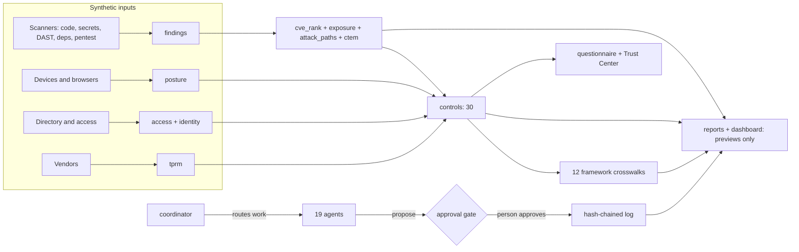
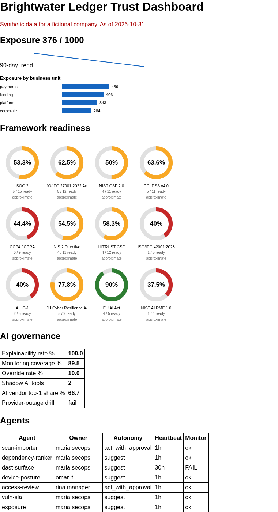
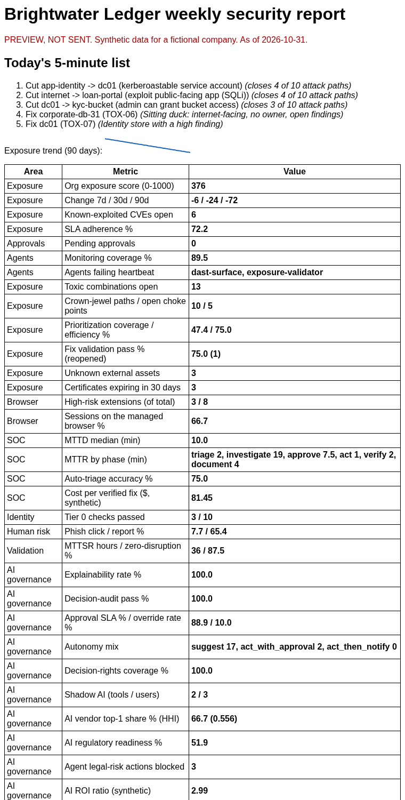
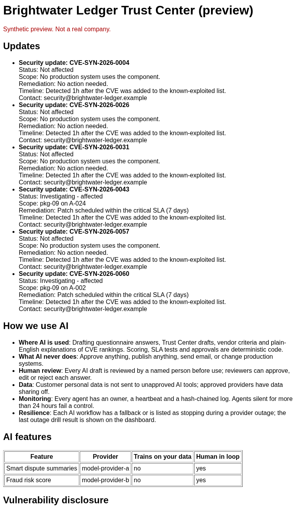

# Continuous Security Program (agentic, offline, human-approved)

[](https://github.com/jagadishmazure-jpg/Jagadish-continuous-security-program/actions/workflows/ci.yml)
[](https://github.com/jagadishmazure-jpg/Jagadish-continuous-security-program/actions/workflows/codeql.yml)

A working model of a **continuous security and trust program** for a fictional payments and lending company,
**Brightwater Ledger** (`brightwater-ledger.example`). A coordinator and 19 small agents import scans, rank CVEs,
score exposure, find attack-path choke points, check devices, browsers and access, answer security questionnaires
with citations, run a Trust Center, assess vendors, plan identity recovery, govern their own AI use, and build
daily and weekly leadership reports.

**Agents propose, people approve.** No agent can approve, publish, send, accept a risk or run a destructive step,
and the tests prove it. Everything runs offline on seeded synthetic data with the Python standard library.
Nothing is sent, deployed or billed. **1723 tests** run in about 2 seconds.

## For recruiters (30 seconds)

- **What it shows:** security engineering + GRC + agent governance in one system: exposure management (CVE ranking
  with EPSS and KEV, attack paths, CTEM), posture (devices, managed browser, access reviews, SLAs), trust
  (Trust Center, AI-drafted questionnaires with expert review), vendor risk, identity recovery, SOC authority,
  12 framework crosswalks and executive reporting.
- **Why it is credible:** every number in the docs is printed by the code and re-checked in CI; each is labelled
  measured, synthetic or SIMULATED. Weak results stay visible (16.7% device compliance, one failing AI drill).
- **Engineering hygiene:** SHA-pinned CI, CodeQL security-and-quality, gitleaks, brand check, test-count check,
  documented-output drift check, no runtime dependencies.

## Start here

| If you have | Read |
|---|---|
| 2 minutes | This page and [USE_CASES.md](USE_CASES.md) |
| 15 minutes | [docs/learn/00_START_HERE.md](docs/learn/00_START_HERE.md) then 03, 04, 17 |
| A presentation to give | [PRESENTATION_GUIDE.md](PRESENTATION_GUIDE.md) |
| To build it for real | [docs/implementation-guide.md](docs/implementation-guide.md) |

```bash
python -m pytest -q                 # 1723 tests, offline
python -m secprog five              # the five things to fix this week
python -m secprog report --kind weekly --out out   # leadership report previews (never sent)
python -m secprog dashboard --out out              # Trust Dashboard + Trust Center previews
```

<!-- run: python -m secprog five -->
```text
1. Cut app-identity -> dc01 (kerberoastable service account)  [closes 4 of 10 attack paths]
2. Cut internet -> loan-portal (exploit public-facing app (SQLi))  [closes 4 of 10 attack paths]
3. Cut dc01 -> kyc-bucket (admin can grant bucket access)  [closes 3 of 10 attack paths]
4. Fix corporate-db-31 (TOX-06)  [Sitting duck: internet-facing, no owner, open findings]
5. Fix dc01 (TOX-07)  [Identity store with a high finding]
```
<!-- /run -->

## Architecture



## Screenshots (synthetic data, static previews)

| Trust Dashboard | Weekly report preview | Trust Center preview |
|---|---|---|
|  |  |  |

## What is built and what is planned

| Area | Built (tested) | Planned, not built |
|---|---|---|
| Findings | Importers for 5 scanner types, de-duplication, secrets importer refuses unredacted values | Live connectors |
| Prioritization | CVE ranking v2 (EPSS, KEV, reachability, asset value), exposure score, attack paths, toxic combinations, CTEM loop | Real threat feeds |
| Posture | Device baseline (10 checks), browser extension scoring and session posture, access reviews, vulnerability SLA | Device lock or wipe |
| Trust | Trust Center gating rules, KEV update notes, analytics (SIMULATED), AI questionnaire with citations and expert review | Hosted portal |
| Vendor risk | TPRM assessments with cited criteria, purchase gate | Contract ingestion |
| Identity and SOC | Tier 0 checks, recovery drill (SIMULATED RTO), SOC authority stages, rubber-stamp detection, undo | Live response |
| Governance | 19-agent registry with decision rights, approval gate, policies POL-01..06, AI governance KPIs | Workflow builder, escalation chains |
| Frameworks | 12 frameworks, 110 requirements, readiness rings | Auditor portal |
| Reporting | Daily and weekly HTML, PDF, CSV and .eml previews; cron, GitHub Actions and Logic Apps examples | Any real sending |

## Guardrails

- **No sends.** Reports are previews in `out/`. `reports.send()` refuses without an enabled config, allowed
  recipients, a vault key reference, `approved=True` and a transport; the repo ships no transport.
- **No billable cloud.** No cloud SDKs, no keys, nothing deployed. The Microsoft Foundry / Logic Apps example is a
  disabled sketch.
- **Fictional companies only**, enforced by `scripts/check_brands.py`. Vendor research that inspired features is
  credited in [docs/SOURCE_COVERAGE.md](docs/SOURCE_COVERAGE.md), where every vendor figure is labelled a claim.
- **Every number labelled.** measured (counted by code on synthetic data), synthetic, or SIMULATED (assumption).

## Docs

- Learning path: [docs/learn/](docs/learn/00_START_HERE.md) (00 to 18)
- [USE_CASES.md](USE_CASES.md) · [AGENTS.md](AGENTS.md) · [PRESENTATION_GUIDE.md](PRESENTATION_GUIDE.md)
- [Framework coverage](docs/FRAMEWORK_COVERAGE.md) · [Threat model](docs/threat-model.md) · [ADRs](docs/adr/)
- [Implementation guide](docs/implementation-guide.md) · [Interview points](docs/interview-points.md) ·
  [Glossary](docs/glossary.md) · [Source coverage](docs/SOURCE_COVERAGE.md) · [Security policy](SECURITY.md)

## Related repos

- [Jagadish-arc-ampe-compliance-automation](https://github.com/jagadishmazure-jpg/Jagadish-arc-ampe-compliance-automation):
  the compliance evidence engine whose evidence format this repo copies (no code dependency).

## License

MIT. See [LICENSE](LICENSE).
