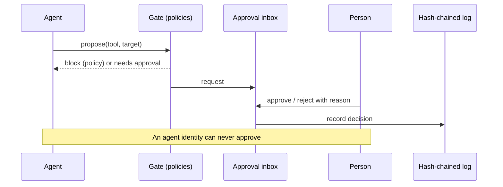

# 02. Concepts

**What you'll learn:** the ten words used on every other page.

**Read this after:** [01_THE_PROBLEM](01_THE_PROBLEM.md)

| Word | Meaning here |
|---|---|
| **Finding** | One security issue on one asset, from any scanner. Two tools reporting the same issue share a fingerprint and count once. |
| **KEV** | A CVE known to be exploited in the wild. In this repo the KEV list is synthetic. |
| **EPSS** | A probability (0 to 1) that a CVE will be exploited soon. Synthetic here. |
| **Exposure score** | 0 to 1000. Asset criticality times the worst open finding risk, rolled up to business units and the company. |
| **Choke point** | An edge in the attack graph that, if removed, cuts the most paths from the internet to a crown jewel. |
| **Toxic combination** | Several weak spots that are only dangerous together, such as "internet-facing + no owner + open findings". |
| **CTEM** | Continuous threat exposure management: scope, discover, prioritize, validate, mobilize. A ticket closes only after a rescan passes. |
| **Evidence** | A typed record (`evidence_id, source, kind, control_hints, content_sha256, collected_at`). Same fields as the companion compliance repo, no code dependency. |
| **Readiness** | Share of a framework's requirements whose mapped controls pass. A partial control counts as half. |
| **Approval** | A request in the inbox decided by a person with the right role. An identity starting with `agent:` can never approve. |

## How a decision flows

## Labels on numbers

- **measured**: counted by the code from the synthetic data (most numbers).
- **SIMULATED**: comes from an assumption written in the code, such as deal values or visit counts.
- **synthetic**: the data itself is invented and seeded, so every run gives the same result.

---

**Next:** [03_ARCHITECTURE](03_ARCHITECTURE.md)
