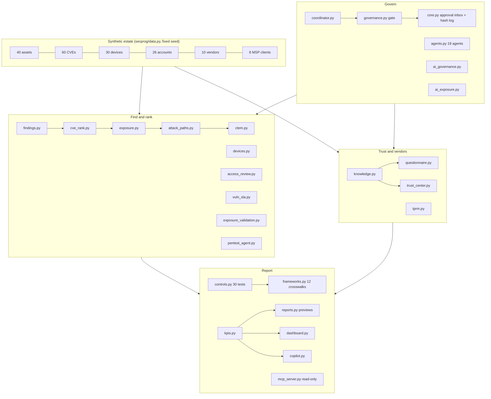

# 03. Architecture

**What you'll learn:** the modules, how data flows between them, and why it is all standard-library Python.

**Read this after:** [02_CONCEPTS](02_CONCEPTS.md)



## Design choices

- **Standard library only.** No runtime dependencies (`dependencies = []`). The PDF writer (`minipdf.py`) and the
  charts (`svgchart.py`) are small and deterministic, so the same input gives the same bytes.
- **No model calls.** Where a real product would call a language model (drafting answers, explaining a rank), this
  repo uses deterministic code and labels it. The governance, approvals and metrics around the AI are the point.
- **One fixed "today".** `TODAY = 2026-10-31`, so ages and due dates never change between runs.
- **Same evidence fields as the companion repo.** `core.Evidence` copies the record format of
  [Jagadish-arc-ampe-compliance-automation](https://github.com/jagadishmazure-jpg/Jagadish-arc-ampe-compliance-automation)
  so files can be read by either tool. There is no import between the repos.

## Module sizes (real)

<!-- run: python -c "import pathlib;fs=sorted(pathlib.Path('secprog').glob('*.py'));print(len(fs),'modules,',sum(len(f.read_text().splitlines()) for f in fs),'lines')" -->
```text
39 modules, 5417 lines
```
<!-- /run -->

---

**Next:** [04_AGENTS](04_AGENTS.md)
