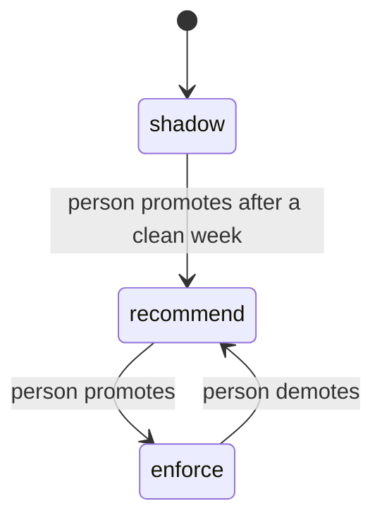

# 04. Agents

**What you'll learn:** the coordinator, the 19 agents (13 core plus 6 specialists), the policy gate, the trust
ladder, and the scorecard that says when an agent is failing.

**Read this after:** [03_ARCHITECTURE](03_ARCHITECTURE.md)

## The coordinator

`secprog/coordinator.py` does four things:

1. **Plans** which agents run for a goal (for example "weekly exposure review" runs six agents in order).
2. **Pre-checks** every proposed action through the policy gate before it runs.
3. **Routes** risky or irreversible actions to the approval inbox. An agent identity can never decide.
4. **Logs** every step in a hash-chained log (`core.HashLog`); changing one old entry breaks `verify()`.

A synthetic week through the coordinator (12 proposals):

<!-- run: python -m secprog coordinator -->
```text
{
  "approved": 9,
  "blocked": 2,
  "log_ok": true,
  "median_review_s": 95,
  "override_rate_pct": 10.0,
  "pending": 0,
  "proposed": 12,
  "rejected": 1,
  "rubber_stamp_flag": false
}
```
<!-- /run -->

`rubber_stamp_flag` turns true when more than half of a reviewer's approvals took under the fast-review threshold
(`core.RUBBER_STAMP_SECONDS`). It is false here; the median review took 95 seconds.

## The policy gate and the trust ladder

Policies are written in plain English and compiled by a small fixed grammar. A sentence the grammar cannot read
is **rejected**; the compiler never guesses. Shipped policies:

| Id | Policy |
|---|---|
| POL-01 | Agents may not send email. |
| POL-02 | Irreversible actions need approval. |
| POL-03 | Agents may not touch kyc-bucket. |
| POL-04 | Agents may only act in tenant brightwater. |
| POL-05 | publish_trust_update needs approval. |
| POL-06 | Agents may not use delete_*. |

Each policy climbs a ladder: **shadow** (log what it would block) -> **recommend** (warn) -> **enforce** (block).
Only a person moves a policy, one step at a time. The same 10 sample actions at each stage:

<!-- run: python -m secprog governance -->
```text
{
  "enforce": {
    "allow": 4,
    "block": 6,
    "warn": 0
  },
  "log_ok": true,
  "recommend": {
    "allow": 4,
    "block": 0,
    "warn": 6
  },
  "shadow": {
    "allow": 10,
    "block": 0,
    "warn": 0
  }
}
```
<!-- /run -->



## The agents and their scorecard

Each agent has an owner (a person), an identity (`agent:<id>`), allowed tools, an autonomy level
(`suggest` by default), a heartbeat, and one outcome metric with a failure threshold. The table is generated from
`secprog/agents.py`:

<!-- run-md: python -m secprog agents-md -->
# AGENTS.md scorecard (generated)

| Agent | Outcome | Metric | Fails when | Accountable human | Autonomy |
|---|---|---|---|---|---|
| scan-importer | Every scan imported and de-duplicated | import success rate | < 99% | maria.secops | act_with_approval |
| dependency-ranker | Exploited CVEs fixed first | coverage at top 12 | < 40% | maria.secops | suggest |
| dast-surface | No unknown internet-facing assets | unowned hosts | > 0 for 7 days | maria.secops | suggest |
| device-posture | Devices meet the baseline | compliant devices | < 80% | omar.it | suggest |
| access-review | Quarterly review completed | campaign completion | < 100% by due date | rina.manager | act_with_approval |
| vuln-sla | Findings fixed within SLA | SLA adherence | < 85% | maria.secops | suggest |
| exposure | Exposure score trending down | org score 30-day change | > 0 (rising) | maria.secops | suggest |
| trust-center | Customers self-serve security answers | self-service rate | < 50% | tess.trust | suggest |
| questionnaire | Questionnaires returned within SLA | turnaround days | > 5 | tess.trust | suggest |
| tprm | Critical vendors assessed on cadence | critical vendors overdue | > 0 | paul.procurement | suggest |
| vciso | Roadmap approved each quarter | roadmap items on track | < 70% | vic.vciso | suggest |
| reporter | Reports on time with real numbers | report build success | < 100% | maria.secops | suggest |
| copilot | Answers cite their source | answers with citations | < 100% | maria.secops | suggest |
| recovery-runbook | Safe, ordered recovery plan | destructive steps with 2 approvals | < 100% | ian.identity | suggest |
| post-action-verifier | No unverified fix counted as done | verified fixes | < 100% of closed | maria.secops | suggest |
| exposure-validator | Only proven exposures reach the queue | unproven findings dropped | n/a | maria.secops | suggest |
| safety-reviewer | No unsafe probe runs | unsafe probes run | > 0 | maria.secops | suggest |
| ai-exposure | Every AI tool registered | unregistered AI tools | > 0 for 14 days | dana.ai | suggest |
| pentest-triage | No phantom findings | phantom findings accepted | > 0 | maria.secops | suggest |
<!-- /run-md -->

Autonomy mix: 17 agents only suggest, 2 act with approval, 0 act and then notify.

## Other agent controls

- **Drift detection** compares what an agent did this week with what it is registered to do. In the synthetic
  week the Trust Center agent tried `send_email` (not registered) and the TPRM agent switched AI provider; both
  are flagged.
- **Monitoring:** an agent with no heartbeat for more than 24 hours fails. Coverage is 89.5% (17 of 19).
- **Harness:** tools are typed; an irreversible tool without an approved request returns
  `blocked: irreversible tool needs approval`, and every decision becomes a decision record.

---

**Next:** [05_WORKFLOWS](05_WORKFLOWS.md)
