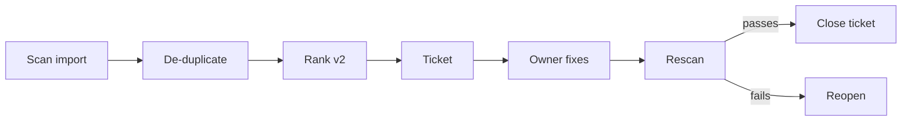

# 05. Workflows

**What you'll learn:** which end-to-end flows run, where a person steps in, and which planned flows are not built.

**Read this after:** [04_AGENTS](04_AGENTS.md)

Each flow below is code with tests, not a diagram. "Person" means a named human role; agents cannot fill it.

| # | Flow | Steps | Person decides | Module |
|---:|---|---|---|---|
| 1 | Scan to fix | import -> de-duplicate -> rank -> ticket -> rescan -> close | owner accepts; close only after rescan | `findings`, `cve_rank`, `ctem` |
| 2 | Vulnerability SLA | due date by severity and asset criticality -> pass/fail -> MTTR | owner fixes | `vuln_sla` |
| 3 | Pentest finding | candidate -> evidence and inventory check -> accept/reject/flag -> retest | tester signs off | `pentest_agent`, `findings` |
| 4 | Exposure validation | propose safe test -> safety review -> validate -> drop unproven | safety reviewer, approver | `exposure_validation` |
| 5 | Access review | find issues -> propose revocation -> reviewer decides each | named reviewer | `access_review` |
| 6 | Questionnaire | draft with citations -> SME queue -> reminders -> ready gate -> approve/edit/reject -> sign-off | expert and signer | `questionnaire` |
| 7 | Trust Center request | NDA rules engine -> approve/deny/review | trust owner for "review" cases | `trust_center` |
| 8 | KEV playbook | KEV CVE -> draft update, KB answer, subscriber email preview | trust owner publishes | `trust_center` |
| 9 | Vendor assessment | intake -> criteria -> assess -> follow-ups -> residual decision -> monitoring | vendor owner, approver | `tprm` |
| 10 | Purchase gate | spend request -> block if approved before security review | security reviewer | `tprm.purchase_gate` |
| 11 | Identity recovery | Tier 0 checks -> choose clean backup -> ordered steps -> two-person approvals | two different people | `identity_recovery` |
| 12 | SOC action | propose -> authority check -> approve -> act -> verify (verified fix becomes CC7.4 evidence) -> undo if wrong | analyst, board for promotions | `soc_authority` |
| 13 | AI control test | agent drafts a test rule -> person approves -> test runs | control owner | `controls.draft_test` |
| 14 | Roadmap | gaps scored -> costed 12-month plan -> vCISO approves | vCISO | `msp.Roadmap` |
| 15 | Reports | metrics -> HTML, PDF, CSV, .eml previews | nobody sends; sending needs config + approval | `reports` |

## Planned, not built

- A general trigger-and-action workflow builder. The flows above are fixed in code. (The companion compliance
  repo has a workflow builder.)
- Escalation of overdue vulnerabilities from owner to manager to CISO.
- Device lock or wipe proposals; device posture is checked and reported only.

---

**Next:** [06_EXPOSURE_AND_FINDINGS](06_EXPOSURE_AND_FINDINGS.md)
