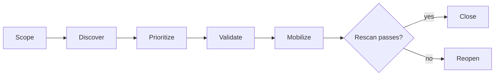

# 06. Exposure and findings

**What you'll learn:** how scans become one findings list, how CVEs are ranked, how the exposure score and attack
paths work, and how a fix is proven before a ticket closes.

**Read this after:** [05_WORKFLOWS](05_WORKFLOWS.md)

## One findings list

`secprog/findings.py` imports synthetic files shaped like common open formats: SARIF for code scanning, a secrets
JSON report, a DAST (web app scan) report, dependency CVEs and pentest results. Each finding gets a fingerprint
from asset + rule or CVE + location, so two tools that report the same issue count once. The secrets importer
refuses any record whose secret value is not already redacted.

<!-- run: python -m secprog findings -->
```text
73 findings after de-duplication; pentest {'fixed': 2, 'open': 1, 'not_retested': 1, 'total': 4, 'retest_coverage_pct': 75.0}
```
<!-- /run -->

## Ranking CVEs: v2 against three baselines

The threat-informed rank (v2) multiplies **threat** by **impact**:

```python
# secprog/cve_rank.py
def threat(c: dict) -> float:
    t = (0.35 * c["kev"] + 0.25 * c["epss"] / 0.97 + 0.2 * MATURITY_W[c["maturity"]]
         + 0.05 * min(c["news"], 5) / 5 + 0.05 * c["industry_targeted"] + 0.1 * c["reachable"])
    return round(t, 4)
```

`score = 100 x threat x (0.5 + 0.5 x asset criticality / 10)`. Every rank carries a reason such as "on the
known-exploited list, EPSS 0.62, weaponized exploit, reachable code path, asset criticality 9".

The synthetic set marks 19 of 60 CVEs as "exploited later". **Coverage** is the share of those 19 found in the top
12; **efficiency** is the share of the top 12 that were exploited later:

<!-- run: python -m secprog rank -->
```text
method         coverage%  efficiency%
threat_v2           47.4         75.0
kev_epss_v1         36.8         58.3
epss_only           31.6         50.0
cvss_only           15.8         25.0
synthetic labels; regression check, not a real-world accuracy claim
```
<!-- /run -->

This is a **regression check** on invented labels. It shows the method works as designed; it is not a
real-world accuracy claim.

## Exposure score

Asset criticality (1 to 10) comes from rules: data class, internet exposure, crown-jewel tag and kind. A person
can override it; the override always wins and is logged. Asset exposure is criticality times the worst open
finding risk (0 to 1000); business-unit and company scores are criticality-weighted means.

<!-- run: python -m secprog exposure -->
```text
org 376 / 1000
  payments  459
  lending   406
  platform  343
  corporate 284
trend {'7d': -6, '30d': -24, '90d': -72}
```
<!-- /run -->

## Attack paths, choke points and toxic combinations

The graph links the internet, assets, vulnerabilities, identities, roles and data stores. Each edge carries a
MITRE ATT&CK technique id. A **choke point** is the edge whose removal cuts the most paths to a crown jewel.

<!-- run: python -m secprog paths -->
```text
app-identity -> dc01         closes 4/10  (T1558)
internet -> loan-portal      closes 4/10  (T1190)
dc01 -> kyc-bucket           closes 3/10  (T1098)
dc01 -> ledger-db            closes 3/10  (T1003)
internet -> pay-gateway      closes 3/10  (T1190)
toxic combinations: {'TOX-01': 0, 'TOX-02': 2, 'TOX-03': 2, 'TOX-04': 1, 'TOX-05': 2, 'TOX-06': 2, 'TOX-07': 1, 'TOX-08': 1, 'TOX-09': 1, 'TOX-10': 1}
```
<!-- /run -->

The 10 toxic-combination rules (TOX-01 to TOX-10) include "internet-facing + known-exploited CVE", "crown jewel
with a critical finding", "sitting duck: internet-facing, no owner, open findings" and "AI workload +
over-privileged identity + exposed endpoint". TOX-01 matched nothing this run; that is shown, not hidden.

## CTEM: close only after a rescan



<!-- run: python -m secprog ctem -->
```text
{
  "closed": 3,
  "fix_validation_pass_pct": 75.0,
  "log_ok": true,
  "reopened": 1,
  "stage": "done"
}
```
<!-- /run -->

## The 5-minute list

If you only have five minutes today, `python -m secprog five` mixes choke points, toxic combinations and the top
v2 CVEs and sorts by impact (shown on [00_START_HERE](00_START_HERE.md)).

## Validation and pentest controls

- **Exposure validation (simulated, no packets sent):** a safety-reviewer gate refuses unsafe tests (production
  writes, denial of service, out of scope). Findings that cannot be proven are dropped from the urgent list;
  compensating controls earn partial credit instead of hiding a finding.

<!-- run: python -m secprog validate -->
```text
{
  "basis": "simulated validation; synthetic change history",
  "credited_by_controls": 2,
  "dropped_unproven": 2,
  "leaked_credential_matches": 3,
  "mttsr_hours": 36,
  "refused_by_safety_reviewer": 1,
  "validated_urgent": 2,
  "zero_disruption_pct": 87.5
}
```
<!-- /run -->

- **Pentest assistant hallucination controls:** a candidate on an asset that is not in the inventory, or a port
  the scanner never saw open, is a phantom and is rejected. No reproducible evidence: rejected. Confidence under
  0.90: flagged for a human tester.

<!-- run: python -m secprog pentest -->
```text
AI-PT-01 accepted (pending tester sign-off) evidence and inventory match
AI-PT-02 accepted (pending tester sign-off) evidence and inventory match
AI-PT-03 rejected                           phantom: asset not in inventory
AI-PT-04 rejected                           phantom: port not seen open by the scanner
AI-PT-05 flagged                            confidence 0.78 < 0.90; tester must confirm
AI-PT-06 rejected                           no reproducible evidence
AI-PT-07 accepted (pending tester sign-off) evidence and inventory match
```
<!-- /run -->

## Read-only MCP server

`secprog/mcp_server.py` answers JSON-RPC shaped calls for `get_exposure_score`, `top_choke_points` and
`explain_cve_rank`. Any write-like tool name is refused; writes go through the approval inbox, never through
this server. It runs as a function call, with no network listener.

---

**Next:** [07_POSTURE_AND_ACCESS](07_POSTURE_AND_ACCESS.md)
