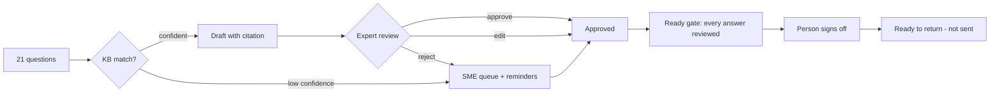

# 08. Trust Center and questionnaires

**What you'll learn:** how the questionnaire agent drafts cited answers, how an expert approves, edits or rejects
them, how accuracy is measured, and how the Trust Center gates documents.

**Read this after:** [07_POSTURE_AND_ACCESS](07_POSTURE_AND_ACCESS.md)

## Questionnaire flow



Each draft cites a page and section of a synthetic source document, for example:

```text
Q01  Is customer data encrypted at rest?
     Yes. Customer data is encrypted at rest with AES-256.
     cites: SOC2-2026 p.4 (Section 3 System description)   reviewer: tess.trust   state: approved
```

One question is a deliberate trap. "Are employee laptops encrypted at rest?" looks like the KB answer about
customer data, so the agent drafts it with confidence 0.5. The expert **rejects** that draft and an SME answers
from the device posture report ("28 of 30 devices comply today"). Measured result:

<!-- run: python -m secprog questionnaire -->
```text
{
  "accuracy_pct": 86.7,
  "approved_as_drafted": 13,
  "auto_answer_rate_pct": 61.9,
  "drafted_by_agent": 15,
  "edited": 1,
  "questions": 21,
  "rejected_drafts": 1,
  "routed_to_sme": 6,
  "sign_off": "ready to return (not sent)",
  "sme_reminders": 6,
  "turnaround_days": 3,
  "within_sla": true
}
```
<!-- /run -->

- **Accuracy 86.7%** = drafts approved without change / drafts (13 of 15). One draft was edited and one rejected.
- **Auto-answer rate 61.9%** = approved drafts / all questions (13 of 21).
- 21 synthetic questions is a **regression check**, not a quality claim about any model.

## Knowledge-base hygiene

`questionnaire.KBQueue` holds proposed KB answers until a person approves them (an author cannot approve their own).
`scrub` replaces other customers' names with `[customer]`, `duplicates` finds near-identical KB questions,
`conflicts` finds two answers on the same topic that state different numbers, and `spot_check` takes a quarterly
sample plus every entry older than 180 days.

## Trust Center

Documents are **public** or **gated**. A gated request is decided by a pure, versioned NDA rules engine
(`2026.10-r3`). Anything the rules do not cover goes to a person (R9).

<!-- run: python -m secprog trust -->
```text
AR-01 approve  R3 NDA on file and active deal
AR-02 deny     R1 personal email domain
AR-03 approve  R4 existing customer (MSA covers confidentiality)
AR-04 deny     R2 listed competitor
AR-05 review   R9 no rule matched; a person decides
AR-06 approve  R0 public document
AR-07 approve  R3 NDA on file and active deal
{
  "emails_sent": 0,
  "kev_cves": 6,
  "median_hours_to_first_update": 4.0,
  "template_fields": [
    "Status",
    "Scope",
    "Remediation",
    "Timeline",
    "Contact"
  ],
  "updates_published": 6
}
```
<!-- /run -->

The second block is the **known-exploited CVE playbook**: for each KEV CVE the agent drafts a Trust Center update
(Status, Scope, Remediation, Timeline, Contact), a KB answer and a subscriber email preview. A person publishes;
`emails_sent` is always 0.

The Trust Center preview page also has a vulnerability disclosure policy (VDP), a "How we use AI" section and an
AI feature table (provider, trains on your data, human in the loop). See
[docs/img/trust_center.png](../img/trust_center.png).

## Analytics and trust-to-revenue (SIMULATED)

<!-- run: python -m secprog trust-metrics -->
```text
{
  "ai_roi": {
    "ai_cost_per_month": 900.0,
    "basis": "SYNTHETIC inputs; review time by people is subtracted",
    "hours_saved_gross": 36.0,
    "hours_saved_net": 28.4,
    "review_hours": 7.7,
    "roi_ratio": 2.99,
    "value_per_month": 2693.25
  },
  "analytics": {
    "access_requests": 7,
    "auto_decided_pct": 85.7,
    "basis": "SIMULATED visit and download counts; decisions measured",
    "doc_downloads_30d": 233,
    "questions_self_served_pct": 58.0,
    "visits_30d": 1420
  },
  "insurance": {
    "basis": "synthetic controls",
    "gaps": [
      "MFA for all privileged accounts",
      "EDR on all endpoints",
      "Critical patches applied within 30 days",
      "No RDP exposed to the internet"
    ],
    "readiness_pct": 60.0,
    "ready": 6,
    "total": 10
  },
  "trust_to_revenue": {
    "basis": "SIMULATED deal values",
    "deals_touching_trust_center": 3,
    "pipeline_influenced": 515000
  }
}
```
<!-- /run -->

Visits, downloads and deal values are **SIMULATED**. Decision counts (`auto_decided_pct`) are measured from the
rules engine. `ai_roi` and `insurance` are explained on pages 13 and 10.

---

**Next:** [09_VENDOR_RISK](09_VENDOR_RISK.md)
