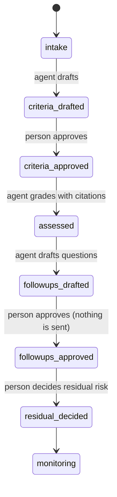

# 09. Vendor risk

**What you'll learn:** how the TPRM agent drafts criteria and grades a vendor with citations while every decision
stays with a person, and how the purchase gate catches spend approved before security review.

**Read this after:** [08_TRUST_AND_QUESTIONNAIRES](08_TRUST_AND_QUESTIONNAIRES.md)

## The assessment state machine



The agent grades each criterion as **Met**, **Partially Met**, **Not Met** or **Inconclusive**, with a citation
to the vendor document. Inconclusive is not a failure; it means "ask again". Three fictional vendors:

<!-- run: python -m secprog tprm -->
```text
{
  "Inconclusive": 2,
  "Met": 7,
  "Not Met": 1,
  "Partially Met": 2,
  "cited_pct": 83.3,
  "criteria": 12,
  "followups": 5,
  "residual": "medium",
  "state": "monitoring",
  "vendor": "V-03"
}
{
  "Inconclusive": 0,
  "Met": 7,
  "Not Met": 0,
  "Partially Met": 0,
  "cited_pct": 100.0,
  "criteria": 7,
  "followups": 0,
  "residual": "low",
  "state": "monitoring",
  "vendor": "V-04"
}
{
  "Inconclusive": 7,
  "Met": 4,
  "Not Met": 1,
  "Partially Met": 0,
  "cited_pct": 41.7,
  "criteria": 12,
  "followups": 8,
  "residual": "medium",
  "state": "monitoring",
  "vendor": "V-09"
}
```
<!-- /run -->

- V-04 sent a complete packet: every criterion met and cited.
- V-09 sent little: 7 of 12 inconclusive, only 41.7% cited, 8 follow-up questions drafted.
- An agent trying to approve criteria or decide residual risk raises `PermissionError`; tests prove it.

Reassessment cadence depends on tier; three vendors (V-03, V-07, V-08) are due or triggered by an event.

## Purchase gate

<!-- run: python -m secprog purchases -->
```text
PR-101 Copperline Model Hosting     ok
PR-102 Ashgrove Analytics           BLOCKED: spend approved before security review
PR-103 Meadowlark Swag Store        ok (exempt: low tier, small amount)
PR-104 Silverbrook KYC              ok
PR-105 Harborview Help Desk         BLOCKED: spend approved before security review
```
<!-- /run -->

A small, low-tier purchase is exempt. Spend approved before a security review is blocked until the review is done.

---

**Next:** [10_IDENTITY_SOC_HUMAN](10_IDENTITY_SOC_HUMAN.md)
