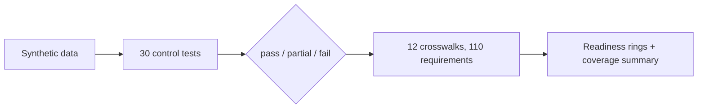

# 12. Frameworks and readiness

**What you'll learn:** how 30 control tests feed 12 framework crosswalks, how readiness is computed, and what
the numbers do and do not mean.

**Read this after:** [11_MSP_AND_VCISO](11_MSP_AND_VCISO.md)

## From control tests to readiness

`secprog/controls.py` holds 30 internal controls (CTL-01 to CTL-30). Each has a deterministic test that reads the
synthetic data and returns pass, partial or fail with the measured value. Today: **12 pass, 11 partial, 7 fail.**

`secprog/frameworks.py` maps framework requirements to those controls. For each requirement the **weakest mapped
control decides** (pass = 1, partial = 0.5, fail = 0). Readiness % is the mean over mapped requirements. A
requirement with no mapped control is a **gap** and is listed separately (it is left out of the percentage and
shown as a gap instead).



## Framework coverage summary

<!-- run-md: python -m secprog coverage -->
| Framework | Requirements | Mapped | Ready | Readiness |
|---|---:|---:|---:|---:|
| SOC 2 (2017 TSC) | 15 | 15 | 5 | 53.3% |
| ISO/IEC 27001:2022 Annex A | 12 | 12 | 5 | 62.5% |
| NIST CSF 2.0 | 11 | 11 | 4 | 50.0% |
| PCI DSS v4.0 | 11 | 11 | 5 | 63.6% |
| CCPA / CPRA | 9 | 9 | 0 | 44.4% |
| NIS 2 Directive | 11 | 11 | 4 | 54.5% |
| HITRUST CSF (control categories) | 12 | 12 | 4 | 58.3% |
| ISO/IEC 42001:2023 (AI management) | 5 | 5 | 1 | 40.0% |
| AIUC-1 (AI agent standard) | 6 | 5 | 2 | 40.0% |
| EU Cyber Resilience Act | 9 | 9 | 5 | 77.8% |
| EU AI Act (deployer duties, subset) | 5 | 5 | 4 | 90.0% |
| NIST AI RMF 1.0 | 4 | 4 | 1 | 37.5% |

**Total:** 12 frameworks, 110 requirements, 109 mapped, 1 gap; mapping type: approximate 12; 30/30 controls used.
<!-- /run-md -->

<!-- run: python -m secprog frameworks -->
```text
SOC 2 (2017 TSC)                          53.3%  (5/15 ready)
ISO/IEC 27001:2022 Annex A                62.5%  (5/12 ready)
NIST CSF 2.0                              50.0%  (4/11 ready)
PCI DSS v4.0                              63.6%  (5/11 ready)
CCPA / CPRA                               44.4%  (0/9 ready)
NIS 2 Directive                           54.5%  (4/11 ready)
HITRUST CSF (control categories)          58.3%  (4/12 ready)
ISO/IEC 42001:2023 (AI management)        40.0%  (1/5 ready)
AIUC-1 (AI agent standard)                40.0%  (2/5 ready)
EU Cyber Resilience Act                   77.8%  (5/9 ready)
EU AI Act (deployer duties, subset)       90.0%  (4/5 ready)
NIST AI RMF 1.0                           37.5%  (1/4 ready)
12 frameworks, 110 requirements, 1 gap(s)
```
<!-- /run -->

- **CCPA / CPRA, NIS 2 and HITRUST CSF** are the newest crosswalks. CCPA has 0 fully ready requirements but
  44.4% readiness, because most of its requirements map to partial controls (for example data-subject request
  timeliness).
- **AIUC-1** has one gap (requirement F): no control here covers it yet. Counting the gap as 0 would give 33.3%.
- **Every mapping is "approximate".** Requirement ids are real section numbers, but the short names are our own
  paraphrases, and the mappings are our reading. This is not legal advice or an auditor's opinion.
- **Readiness numbers come only from the synthetic control results**, never from a vendor screenshot or survey.

## AI-generated control tests

An agent can draft a new control test as a small rule (`metric`, operator, threshold). It stays a draft until a
person approves it with a reason; an unapproved draft cannot run and never counts toward readiness.

```python
t = controls.draft_test("CTL-01", "ai_answer_accuracy", ">=", 80)
t.run()                                   # PermissionError: not approved
t.approve("agent:copilot", "ok")          # PermissionError: agents cannot approve
t.approve("amara", "threshold matches policy")
t.run()                                   # "pass"
```

The readiness rings (one SVG card per framework) are on the Trust Dashboard: [docs/img/dashboard.png](../img/dashboard.png).

---

**Next:** [13_AI_GOVERNANCE](13_AI_GOVERNANCE.md)
