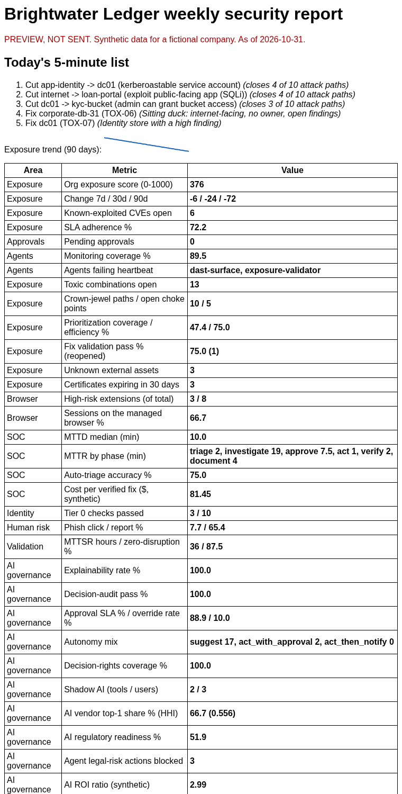
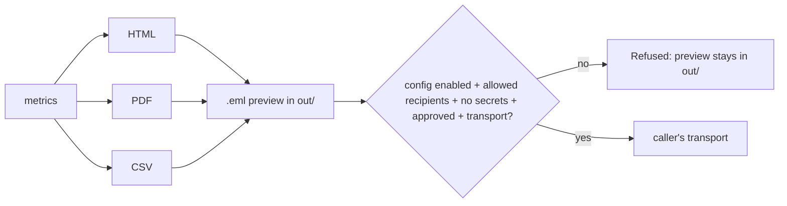

# 14. Executive reporting

**What you'll learn:** what the daily and weekly leadership reports contain, the four preview formats, why nothing
is ever sent by default, and how to schedule them with cron, GitHub Actions or Microsoft Foundry and Logic Apps.

**Read this after:** [13_AI_GOVERNANCE](13_AI_GOVERNANCE.md)

## Previews only

```bash
python -m secprog report --kind daily  --out out
python -m secprog report --kind weekly --out out
```

<!-- run: python -m secprog report --kind weekly --out out -->
```text
out/reports/weekly.csv
out/reports/weekly.eml
out/reports/weekly.html
out/reports/weekly.pdf
previews only; nothing was sent
```
<!-- /run -->

| File | What it is |
|---|---|
| `out/reports/weekly.html` | HTML email body with inline SVG charts (no JavaScript, no external images) |
| `out/reports/weekly.pdf` | The same numbers as a PDF, built by the tiny standard-library writer `minipdf.py` |
| `out/reports/weekly.csv` | One row per metric: `section,metric,value,basis` |
| `out/reports/weekly.eml` | A complete email with the PDF and CSV attached. Subject starts with `[PREVIEW - NOT SENT]` and it has the header `X-SECPROG-Preview: true` |

The daily report is a short subset (exposure, KEV, SLA, pending approvals, agent heartbeats). The weekly report
adds toxic combinations, choke points, prioritization, fix validation, browser and extension risk, SOC phase
times, Tier 0 checks, phishing rates, framework readiness and the AI governance KPIs.



## Why it never sends by default

`reports.send()` refuses unless **all** of these are true:

1. A send config exists and `enabled` is `true`.
2. `transport` is `smtp`, `sendgrid` or `logic_apps`.
3. Every recipient is inside `allowed_domains`.
4. The config holds no secret (`api_key`, `password`, `token`); keys must come from a vault reference.
5. The caller passes `approved=True` (a person approved this send).
6. The caller supplies a transport function. **This repo ships none.**

Each missing item is listed in the `SendRefused` message. Tests cover every refusal.



## Scheduling examples (all previews only)

| Option | File | What runs |
|---|---|---|
| cron | [examples/schedulers/crontab.txt](../../examples/schedulers/crontab.txt) | 07:00 New York time, daily on weekdays and weekly on Mondays |
| GitHub Actions | [examples/schedulers/github-actions-reports.yml](../../examples/schedulers/github-actions-reports.yml) | Builds previews and uploads them as an artifact. Not active in this repo. |
| Microsoft Foundry + Logic Apps + SendGrid | [examples/schedulers/logic-app-approval-workflow.example.json](../../examples/schedulers/logic-app-approval-workflow.example.json) | A disabled workflow sketch: build preview -> wait for a named approver -> only then call the mail connector |
| Send config | [examples/schedulers/send-config.example.json](../../examples/schedulers/send-config.example.json) | `enabled: false`; the key is a vault reference |

<!-- run: python -m secprog schedule -->
```text
# Continuous security program reports (previews only unless sending is configured AND approved)
CRON_TZ=America/New_York
0 7 * * 1-5 cd /opt/continuous-security-program && python -m secprog report --kind daily --out out
0 7 * * 1 cd /opt/continuous-security-program && python -m secprog report --kind weekly --out out
```
<!-- /run -->

### Microsoft Foundry, Logic Apps and SendGrid (design, not deployed)

In an Azure setup, a Microsoft Foundry agent could write the plain-English summary paragraph, a Logic App would
run on the schedule, an approval step would wait for a named person, and only after "Approve" would the SendGrid
(or Office 365) connector send. The key would live in Key Vault. **Nothing here is deployed**; deploying would create
billable resources and needs the owner's approval and a cost estimate first.

---

**Next:** [15_USE_CASES](15_USE_CASES.md)
