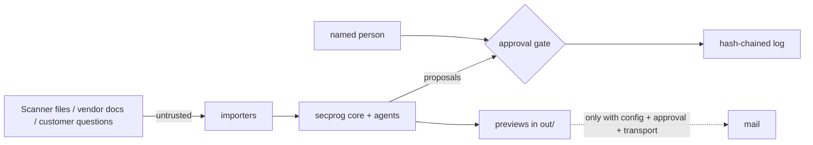

# Threat model

Scope: the agents, the approval gate, the Trust Center and questionnaire flow, the reports, and the MSP tenant
boundary, as they would run in a real deployment. Method: STRIDE for the system, OWASP Top 10 for LLM
applications for the AI parts.

## STRIDE

| Threat | Example | Control in this repo | Test |
|---|---|---|---|
| Spoofing | An agent identity tries to approve as a person | Gate checks identity type; agents raise `ApprovalError` / `PermissionError` | `test_agents_gov.py`, `test_browser.py` |
| Tampering | Someone edits a past decision | Hash-chained log; `log_ok` false fails the run | `test_core.py` |
| Repudiation | "I never approved that" | Every decision stores who, when, reason | `test_core.py` |
| Information disclosure | Secrets in scan files; browser content; cross-tenant queries | Secrets importer refuses unredacted values; events keep a content hash only; 56 cross-tenant queries refused with 0 canary leaks | `test_findings_rank.py`, `test_browser.py`, `test_program.py` |
| Denial of service | Approval inbox flooded so reviewers rubber-stamp | Approval SLA and median review time measured; vCISO queue ordered by risk; rubber-stamp flags | `test_agents_gov.py`, `test_program.py` |
| Elevation of privilege | Agent acts outside its decision rights; rubber-stamp approvals | Decision rights per agent; rubber-stamp detection (reviews under 15 s) | `test_ops.py`, `test_agents_gov.py` |

## OWASP LLM Top 10 (the parts that apply)

| Risk | Where | Control |
|---|---|---|
| LLM01 Prompt injection | Vendor documents, recovery runbooks | Injected instructions in synthetic docs are ignored (identity drill counts `injections_ignored`) |
| LLM02 Sensitive information disclosure | Questionnaire answers, Trust Center | Gated documents with rules; answers cite approved sources only |
| LLM05 Improper output handling | Reports and dashboard | Static HTML, no scripts, no external URLs (tested) |
| LLM06 Excessive agency | All agents | Propose-only autonomy, two-person rule for destructive steps |
| LLM09 Misinformation | AI drafts | Expert approve/edit/reject; accuracy measured; uncited drafts routed to an expert |

## Out of scope here

Real network attackers, supply chain of a hosted deployment, and model-level attacks (no model is called).
